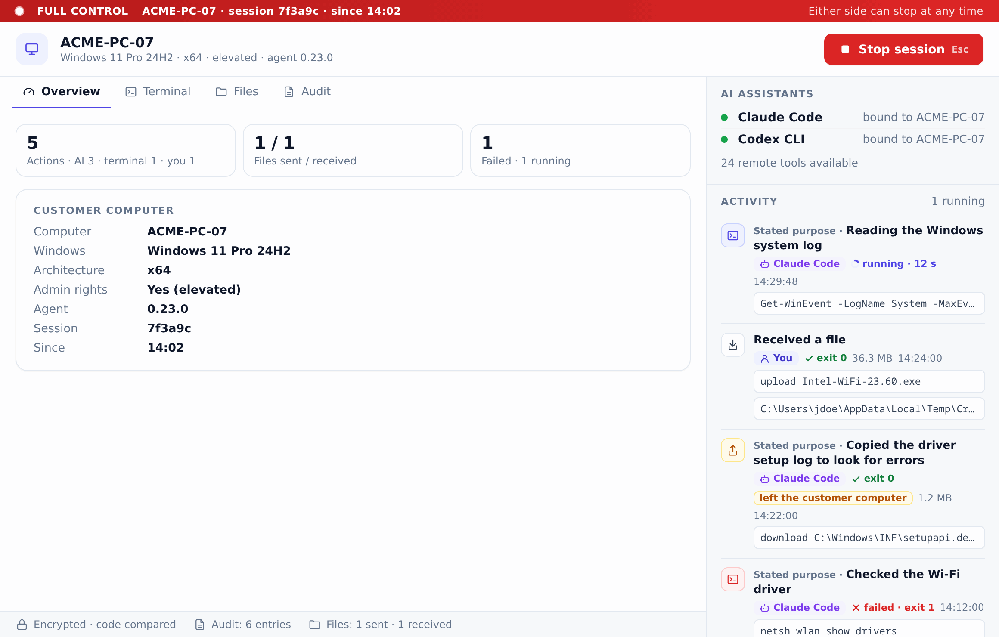
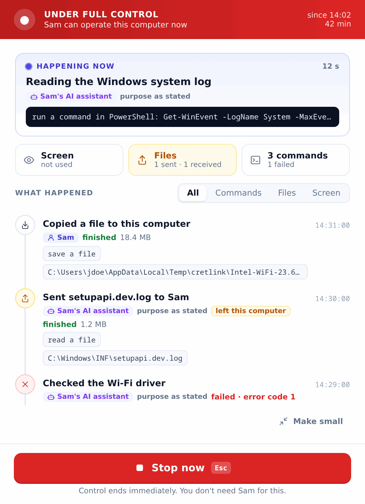

# CretLink

**Attended remote support, driven by your own AI agent.**

CretLink lets an AI agent on a technician's computer work on a customer's
Windows computer, in a session that the customer starts, approves, watches and
can stop at any moment. The agent is the one you already use: Claude Code,
Codex CLI, Gemini CLI or another client that speaks the Model Context Protocol
(MCP). The customer's computer needs no AI program, no AI account and no API
key.

<p align="center">
  
  &nbsp;
  
</p>
<p align="center"><sub>One session from both sides: the technician's window and the customer's window. Sample data.</sub></p>

## How a session goes

1. **The technician** starts `cretlink`, chooses **Give help** and waits for
   the customer.
2. **The customer** starts the same program, chooses **Get help** and answers
   the Windows administrator prompt. A copy named `CretLink-Support.exe` opens
   Get help straight away, for example from a USB stick. Nothing is installed.
3. The customer picks the technician from the computers found on the network,
   or types the connection code the technician gives them.
4. Both windows show the same six digits. The technician reads them aloud;
   when they differ, either person stops.
5. The customer reads what full control means, then allows or declines it.
6. The technician's AI agent works through CretLink: it runs PowerShell and
   Command Prompt commands, follows and cancels jobs, and sends and fetches
   files. Both windows show every action as it happens, with the purpose the
   agent stated for it.
7. Either person stops the session. CretLink removes what it placed on the
   customer's computer and reports what it could not remove.

The connection is direct, authenticated and encrypted end to end, between two
computers on the same network. AI credentials, provider tokens and login state
stay on the technician's computer.

## Get started

1. Download the archive for your operating system from the
   [latest release](https://github.com/yveslaurentcreton/CretLink/releases/latest)
   and [verify it](docs/verifying-artifacts.md). Use the same release on both
   computers: a session starts only when both speak the same protocol version.
2. On the technician's computer, unpack it, start `cretlink` and choose
   **Give help**, then **Install for me** or **Run once without installing**
   (see below).
3. Connect your AI clients from the **AI assistants** screen, or with
   `cretlink mcp install`. [MCP client setup](docs/mcp-clients.md) has the
   details and the manual configuration for each client.
4. Give the customer `cretlink.exe` from the Windows archive, renamed to
   `CretLink-Support.exe`, and follow the steps above.

The releases are not code-signed yet, so Windows shows a warning for an
unknown publisher. The checksums are the integrity check for now.

## Run once or install

The technician side is one program, `cretlink`, that runs from wherever it was
unpacked. Its start screen offers, under **Give help**:

- **Run once without installing.** The copy writes nothing but its audit trail
  (in the per-user data folder). AI clients you connect from it point at this
  copy and break when it is moved or deleted; the AI assistants screen says so.
- **Install for me.** Copies `cretlink` (and `cretlink-cli`) to a fixed
  per-user location — `%LOCALAPPDATA%\Programs\CretLink\` on Windows,
  `~/Applications/CretLink.app` on macOS, `~/.local/bin/` on Linux — adds a
  Start-menu shortcut (Windows) or a desktop entry (Linux), connects the AI
  clients you select, and starts the installed copy. It needs no administrator
  rights and adds no service and nothing that starts by itself. Installing a
  newer download again updates the copy in place, so the AI clients keep
  working.

`cretlink uninstall` (or **Uninstall** in Settings, or the Windows *Installed
apps* entry) shows what it will remove and asks first, then removes the
installed files, the shortcut or desktop entry, the uninstall entry and the AI
client registrations the install made, but only while they still point at the
installed copy. The audit trail stays. On macOS and Linux an installed copy
opens Give help directly; a copy that is not installed shows the start screen
so it can still be installed. A `CretLink-Support*` copy, for customers, never
installs or uninstalls; the one command it accepts is `recover [--remove]`.

## Platforms

- **Technician side** (Give help, the MCP bridge `cretlink mcp`, and the
  experimental terminal client `cretlink-cli shell`): Windows and macOS.
- **Customer side** (Get help): Windows. The customer role exists only in the
  Windows build of `cretlink`.
- **Linux** builds exist for operating the relay server and for development.

Each release has one archive per operating system, for Windows x86_64, macOS
aarch64, and Linux x86_64. It holds the application `cretlink` and its console
build `cretlink-cli`, which runs the same subcommands without a window (on
Windows, use it for `shell`). The relay server is attached separately.
`cretlink-console` and `cretlink-support-agent`, the headless technician and
customer programs in the source tree, are development and test tools and are
not released; non-Windows builds of the support agent offer file operations
and piped commands but no interactive terminal, desktop control,
reboot-resume, or privilege reporting.
The Linux binaries run on glibc 2.35 or newer (Ubuntu 22.04 LTS, Debian 12 and
later); the application `cretlink` also needs the WebKitGTK 4.1 webview
(`libwebkit2gtk-4.1-0` on Debian and Ubuntu).

## Current status

CretLink is under active development. Versions are `0.x` pre-releases;
`1.0.0` is reserved for the first usable attended-LAN release.

- **Works today:** the attended session on the same network (discovery or a
  connection code, the code comparison, full-control consent, stop from either
  side, cleanup), remote commands and jobs, file transfer, the MCP tools for
  an AI agent, session history with an end report, and offline recovery of
  leftover CretLink resources on Windows (`cretlink recover [--remove]`).
- **Checked on real computers:** sessions between two Windows 11 computers,
  driven by Claude Code and by the Code tab of Claude Desktop, last on
  2026-11-10. The run log in [Manual tests](docs/manual-tests.md) names what
  ran and what is still pending: among others macOS as the technician's
  computer, Codex CLI as the second client, and the
  [release sign-off](docs/release-signoff.md) on the official files.
- **Experimental:** the screenshot, input and clipboard tools, and the
  technician's interactive terminal.
- **In progress:** sessions over the internet. The relay server, which forwards
  only end-to-end encrypted traffic, is released and
  [documented](docs/relay-server.md), but the application cannot use a relay
  yet. Attended reboot-resume has its building blocks (a customer-armed,
  single-use, expiring ticket that never restores control without fresh
  consent) but is not wired into an actual reboot.

Official releases are built by the release workflow and ship with SHA-256
checksums, a dependency inventory, and CycloneDX SBOMs.

## Documentation

- [MCP client setup](docs/mcp-clients.md)
- [Verifying release artifacts](docs/verifying-artifacts.md)
- [Relay server operation](docs/relay-server.md)
- [Threat model](docs/threat-model.md) and [security policy](SECURITY.md)
- [Manual tests](docs/manual-tests.md) and
  [release sign-off](docs/release-signoff.md)
- [Release policy](docs/releasing.md)

Development setup, build commands, and the dependency policy are documented in
[CONTRIBUTING.md](CONTRIBUTING.md).

The requirements, milestones, stories, and architecture decisions are
maintained in a separate specification repository. Code, commits, and pull
requests refer to them by ID (`REQ-*`, `M###`, `ST-M###-###`, `ADR-####`).
The project follows a strict spec-first workflow:

```text
requirements → milestones → stories → implementation → verification
```

Milestones describe product outcomes. semantic-release independently derives
versions from Conventional Commits. Development uses GitHub Flow: short-lived
story branches, pull requests, required verification, and squash merges into a
releasable `main`.

## License

Copyright © 2026 Yves-Laurent Creton.

Licensed under the [MIT License](LICENSE).
